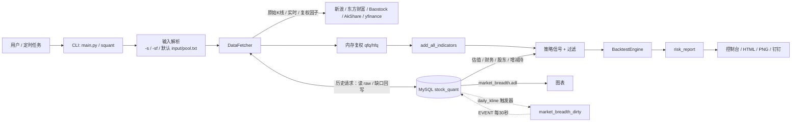
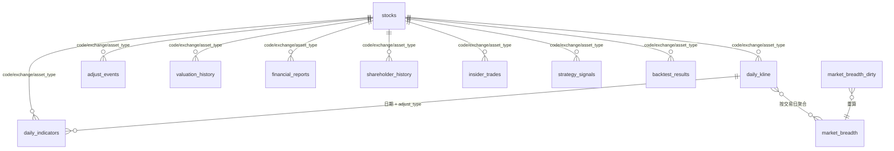

# stock-quant 数据流转与数据库结构

本文说明 `stock-quant` 从数据获取、标准化、入库、读取、指标计算、策略回测到报告输出的完整链路，并给出 MySQL `stock_quant` 的核心表结构与关系。

配套图：[`data_flow.puml`](data_flow.puml)

---

## 1. 总体架构



分层职责：

| 层 | 主要模块 | 职责 |
|----|----------|------|
| 输入层 | `main.py`、`gui.py`、`poolmgr.py` | GUI/CLI 解析参数、股票池、股票名称、日期和策略 |
| 获取层 | `core/data_fetcher.py` | 多源测速/回退、原始 K 线、实时行情、复权因子、指数/榜单/基本面兜底 |
| 存储层 | `core/db.py`、`data/stock_quant.sql` | MySQL 连接、读写、资产类型标准化、广度重算 |
| 计算层 | `core/indicators.py`、`strategies/` | 技术指标、策略信号、信号过滤 |
| 回测层 | `core/backtest.py`、`core/risk.py` | 交易模拟、绩效与风险指标 |
| 输出层 | `visualization/charts.py`、`main.py` | 控制台表格、PNG 图表、HTML 报告、钉钉通知 |

---

## 2. 输入与股票来源

### 2.1 CLI 命令

| 命令 | 输入 | 主要输出 |
|------|------|----------|
| `analyze` | `-s`、`-sf`、`-h`、默认 `input/pool.txt` | 单/多股票策略分析、HTML 报告、图表 |
| `backtest` | `-s`、`-sf`、`--random`、默认 `input/pool.txt` | 批量回测表格、报告、图表 |
| `scan` | 全市场列表 + 排序/随机抽样 | Top N 股票及信号表 |
| `compare` | `-s` 单只股票 | 多策略对比、对比图 |
| `indicators` | `-s` 单只股票 | 指标 CSV / 全因子 K 线 HTML |
| `poolmgr`（独立程序） | `-add`、`-addf`、`-rm`、`-rmf`、`-f`、`-l` | 维护 `input/pool.txt`（`代码 名称`） |

`analyze` 和 `backtest` 未指定 `-s` / `-sf` 时，默认等价于：

```text
-sf input/pool.txt
```

### 2.2 股票池与名称

- `input/pool.txt` 每行格式为 `代码 名称`，也兼容纯代码、空格/逗号/制表符分隔。
- `_read_symbols_file()` 只提取 6 位股票代码，忽略名称，因此带名称的池文件不会影响后续分析。
- `analyze` 对非纯数字输入调用 `_resolve_symbol()`，通过新浪 suggest / 实时行情解析代码和名称。
- `poolmgr.py` 在 `-add` / `-addf` 时通过新浪行情补全名称，并写回 `代码 名称`。

### 2.3 配置

配置统一从项目根目录或可执行文件所在目录的 `squant.toml` 读取，核心配置段：

```toml
[tool.stock-quant.database]   # MySQL 连接（可选）
[tool.stock-quant.sqlite]     # stock_predict SQLite 缓存（只读，优先于网络）
[tool.stock-quant.thresholds] # 策略阈值
[tool.stock-quant.service]    # 服务运行时间/策略
[tool.stock-quant.WEBHOOK]    # 钉钉通知
[tool.stock-quant.composite]  # 综合因子权重
```

SQLite 数据源示例：

```toml
[tool.stock-quant.sqlite]
enabled = true
path = "../stock_predict/stock_cache.db"   # 相对项目根目录或绝对路径
```

也可以用环境变量 `STOCK_QUANT_SQLITE` 覆盖路径；`path` 留空时自动探测
`stock_predict/stock_cache.db`、`../stock_predict/stock_cache.db` 等位置。
详见 [`sqlite_source.md`](sqlite_source.md)。

SQLite 数据源可用时，`--src auto` 会优先读本地库，不再启动时测速；只有本地
库缺失该标的/数据过旧时才回退 MySQL/网络。

数据库未配置或连接失败时，相关读写会退化为空结果/跳过写库，不阻断主流程。

---

## 3. 数据获取

### 3.1 数据源

| 源 | 接口/用途 | 特点 |
|----|-----------|------|
| SQLite `sqlite` | stock_predict 本地缓存 `daily_bars`/`adjust`/`stocks` | 只读、离线、1990 年至最新缓存日；库内 hfq × k 转 qfq |
| 新浪 `sina` | K 线、实时行情、复权因子、股票名称 | K 线约 1000 条；实时和复权因子稳定 |
| 东方财富 `eastmoney` | 历史 K 线、股票列表 | 历史覆盖较好，接口可能限流/断连 |
| Baostock `baostock` | 历史 K 线、股票列表 | 依赖登录，可能受账号/黑名单影响 |
| AkShare `akshare` | 长历史 K 线、估值、财务、股东、增减持 | 个股覆盖较好，ETF 支持有限 |
| yfinance `yfinance` | 美股行情 | 仅非 A 股代码使用 |

### 3.2 自动源选择

`set_primary_source(src)` 支持 `auto` / `sqlite` / `sina` / `baostock` / `eastmoney` / `akshare`。

`auto` 规则：

1. stock_predict SQLite 可用：优先读本地库（`daily_bars` + `adjust`），
   本地缺失/过旧时才回退网络。
2. 请求起始日早于 `2023-01-01`：  
   `baostock → eastmoney → akshare → sina`
3. 请求起始日不早于 `2023-01-01`：  
   并行读取各源最小 K 线，成功解析出行情的最快源优先，其余按固定顺序回退。
4. 显式指定 `--src <source>`：  
   首选源优先，失败后按固定顺序回退。

> `--src sqlite` 表示只把 SQLite 当首选；本地库没有的标的仍会自动回退网络，
> 不会因为缺数据直接失败。

新浪 K 线约 1000 条，因此作为最后兜底时会做覆盖检查：若返回首日比请求起点晚超过 15 天，则跳过该源，避免用不完整数据冒充长历史。

### 3.3 A 股 K 线获取流程

`DataFetcher.get_stock_data()` 按结束日期分为两条路径：

```text
结束日 == 今天：
  昨天及以前：读取 daily_kline(adjust_type='raw')
             → 缺口检测/补齐（仅历史区间回写）
  今天：实时行情转单行 K 线（网络失败时用网络 K 线兜底，仍不回写）
  → 历史 + 今日合并去重
  → 内存复权

结束日 < 今天：
  读取 daily_kline(adjust_type='raw')
  → 检查起始/结束偏差及中间间隙（gap > 3 天）
  → 过滤法定长假等非交易日缺口
  → 仅对真实缺失区间走网络补齐
  → 回写 daily_kline(adjust_type='raw')
  → 内存复权
```

结束日为今天时，历史区间使用严格缺口模式（`gap_days=0`）。若数据库整体尚未更新到昨天，交易日历也会缺失该日，因此会强制补最后一段历史数据；节假日请求通常返回空，不会误写。

缺口检测要点（结束日早于今天）：

- 首条记录晚于请求起点超过 3 天 → 补起始段；
- 末条记录早于请求终点超过 3 天 → 补结束段；
- 相邻记录间隔超过 3 天 → 补中间段；
- `is_ignored_gap_range()` 忽略全部由周末/指定节假日窗口组成的缺口；
- `stocks.listed_date` 用于跳过上市前区间；
- 用 `fetch_market_trade_dates()` 判断区间内是否存在真实交易日，避免其他休市日误补；
- 市场交易日按 `(start, end)` 进程内 `lru_cache` 缓存。

节假日窗口（见 `core/trading_calendar.py`）：周末、12/31~1/4、农历 12/28~1/8、4/4~4/7、4/30~5/6、农历 5/4~5/6、农历 8/14~8/17、9/30~10/8。`lunardate` 提供农历转换。

### 3.4 复权

数据库只保存原始价格：

- `daily_kline.adjust_type` 主流程固定为 `'raw'`；
- 前复权/后复权在内存中完成；
- 复权因子来自新浪 `_get_sina_adjust_factor()`；
- 使用 `pandas.merge_asof(..., direction='backward')` 为每个交易日匹配最近一次除权因子。

公式：

```text
前复权 qfq: 复权价 = 原始价 / 前复权因子
后复权 hfq: 复权价 = 原始价 × 后复权因子
```

复权因子获取失败时记录告警，返回原始价格（`attrs['adjust']='raw'`），不写入数据库。

`adjust_events` 表保存除权除息事件（现金分红、送转股、方案描述等），用于查询分红送配历史，不直接作为复权因子来源。

### 3.5 实时行情

当 `-e` 为今天且历史数据最后一条不是今天时：

1. 调用 `get_realtime_quote()` 获取新浪实时行情；
2. 仅当价格 > 0 且行情日期为今天时，追加一条今日 K 线到内存 DataFrame；
3. 不写回数据库，避免缓存未完成的当日数据。

### 3.6 其他数据

| 数据 | 获取方式 | 用途 |
|------|----------|------|
| 指数数据 | `get_index_data()` | 指数分析、指数专属策略 |
| 热门股票 | `get_hot_stocks()` | `analyze -h N` |
| 股票列表 | `get_stock_list()` | `scan`、`backtest --random` |
| 全量代码 | `get_all_stock_codes()` | `-s` 通配符展开 |
| 分红送配 | `get_dividend_data()` | `adjust_events` |
| 估值 | `akshare` → `valuation_history` | 质量/价值因子 |
| 财务 | `akshare` → `financial_reports` | 质量/价值因子 |
| 股东/增减持 | `akshare` → `shareholder_history` / `insider_trades` | 筹码因子 |

基本面数据采用“数据库优先、网络兜底、成功回写”的模式；财务回测按 `announce_date <= 当前交易日` 取数，避免未来函数。

---

## 4. 资产识别与标准化

`core/db.py` 统一处理 `code + exchange + asset_type`：

| 函数 | 作用 |
|------|------|
| `normalize_asset_type()` | 限定 `stock/index/etf/fund/bond` |
| `normalize_exchange()` | `SSE→SH`、`SZSE→SZ`、`BSE→BJ` 等 |
| `infer_exchange()` | 按代码段推断交易所 |
| `infer_asset_type()` | 按代码段推断资产类型 |
| `normalize_instrument()` | 组合标准化为 `(code, exchange, asset_type)` |

资产类型推断规则（简化）：

```text
SH: 000/950 → index；51/56/58 → etf；50/52 → fund；6/9 → stock；1 → bond
SZ: 399 → index；159 → etf；15/16/18 → fund；000/001/002/003/300/301 → stock
BJ: 4/8 → stock
```

`fetch_kline()` / `store_kline()` 的 `asset_type=None` 时会自动推断。  
K 线主键维度为 `(code, exchange, asset_type, trade_date, adjust_type)`，因此同一代码的股票、ETF、指数数据不会互相覆盖。

---

## 5. MySQL 存储结构

### 5.1 连接与写入

- 数据库：`stock_quant`，MySQL 8.0+，字符集 `utf8mb4`。
- 驱动：`PyMySQL`，每次操作创建连接；失败返回 `None` 并跳过。
- 写入：`get_write_connection()` 使用跨进程文件锁 `/tmp/stock_quant_db_write.lock` 串行化，避免并发 `REPLACE` 死锁。
- 数据库缓存模式由 `_DB_MODE` 控制：
  - `0`：不读不写（默认）；
  - `1`：只读；
  - `2`：网络优先并覆盖写。
- K 线缓存通道使用 `force=True`，不受 `_DB_MODE` 限制。

### 5.2 表清单

| 表 | 作用 | 主键/唯一键 | 主要写入方 | 主要读取方 |
|----|------|-------------|------------|------------|
| `stocks` | 资产主表（股票/指数/ETF/基金/债券） | `(code, exchange, asset_type)` | 外部导入/维护 | 资产信息查询 |
| `daily_kline` | 日 K 线原始行情 | `(code, exchange, asset_type, trade_date, adjust_type)` | `DataFetcher._store_kline_df()` | `fetch_kline()`、广度重算 |
| `adjust_events` | 除权除息事件 | `(code, exchange, asset_type, ex_date)` | 分红数据回写 | `get_dividend_data()` |
| `daily_indicators` | 日技术指标 | `(code, exchange, asset_type, trade_date, adjust_type)` | `store_indicators()` | `fetch_indicators()`、`v_daily_full` |
| `valuation_history` | PE/PB/PS/PCF 等估值 | `(code, exchange, asset_type, val_date)` | 质量/价值策略回写 | `fetch_valuation()` |
| `financial_reports` | 财务报告（含公告日/版本） | `(code, exchange, asset_type, report_date, data_version)` | 质量/价值策略回写 | `fetch_financials()` |
| `shareholder_history` | 股东人数变化 | `(code, exchange, asset_type, change_date)` | 质量策略回写 | `fetch_shareholder()` |
| `insider_trades` | 大股东/高管增减持 | `(code, exchange, asset_type, announce_date, shareholder, change_amount)` | 质量策略回写 | `fetch_insider_trades()` |
| `strategy_signals` | 策略信号（预留持久化） | `(code, exchange, asset_type, trade_date, strategy_key, params_hash)` | 可选 | `v_latest_signals` |
| `backtest_results` | 回测汇总（预留持久化） | `(code, exchange, asset_type, strategy_key, start_date, end_date, params_hash)` | 可选 | 结果查询 |
| `market_breadth` | 市场广度与 ADL | `(universe_code, trade_date)` | 触发器 + 存储过程 | 广度策略、ADL 图表 |
| `broad_index_daily` | 宽基指数日线+指标物化 | `(code, exchange, asset_type, trade_date)`，`asset_type='index'` | 指数物化流程 | 指数分析（预留） |
| `market_breadth_dirty` | 广度重算脏日期队列 | `(universe_code, trade_date)` | `daily_kline` 触发器 | 定时事件 |

> `strategy_signals`、`backtest_results`、`broad_index_daily` 当前主要作为预留/物化结构；CLI 主流程的结果以内存回测和报告输出为主。

### 5.3 核心表字段

#### `daily_kline`

```text
code, exchange, asset_type, trade_date,
open, high, low, close, volume,
amount, amplitude, change_pct, change_val, turnover_rate,
adjust_type, is_realtime, created_at
```

关键点：

- `adjust_type` 主流程固定为 `'raw'`；
- `UNIQUE(code, exchange, asset_type, trade_date, adjust_type)`；
- `INDEX(trade_date, exchange, asset_type)` 支撑按交易日扫描和广度计算；
- 写入使用 `REPLACE INTO`。

#### `daily_indicators`

按 `code/exchange/asset_type/trade_date/adjust_type` 存储：

```text
ma5/10/20/30/60,
ema10/12/26/30,
macd_dif/dea/bar,
rsi14,
boll_upper/middle/lower,
kdj_k/d/j,
adx14/plus_di/minus_di,
atr14/obv/cci20/wr14,
vol_ma5/vwap/hv20/mom60
```

#### `market_breadth`

核心字段：

```text
universe_code, trade_date,
advance_count, decline_count, flat_count, total_count,
limit_up_count, limit_down_count,
new_high_20/60/120/250, new_low_20/60/120/250,
up_volume, down_volume, total_volume, total_amount,
avg_change_pct, median_change_pct,
up_ratio, down_ratio, adr, adl, obos,
adr_ma10, adl_ma20, obos_ma10,
source
```

口径：

- 只统计 `daily_kline.asset_type='stock'` 且 `adjust_type='raw'`；
- 涨跌停按代码段使用不同阈值（30/68 开头 19.8%，4/8 开头 29.8%，其余 9.8%）；
- ADL 为累计线：`ADL(t) = ADL(t-1) + (上涨家数 - 下跌家数)`；
- 图表通过 `fetch_market_breadth_adl()` 读取 `universe_code='ALL_A'` 的 ADL，并按股票 K 线日期对齐。

### 5.4 逻辑关系

数据库未定义外键，全部通过 `(code, exchange, asset_type)` 逻辑关联：



### 5.5 视图

| 视图 | 说明 |
|------|------|
| `v_daily_full` | `daily_kline LEFT JOIN daily_indicators`，按 `code/exchange/asset_type/trade_date/adjust_type` 关联 |
| `v_latest_signals` | 每个资产/策略/参数组合的最新信号 |

注意：`v_daily_full` 的关联包含 `adjust_type`。当前主流程 `daily_kline` 为 `raw`、`daily_indicators` 默认 `qfq`，直接查询前需确认两侧 `adjust_type` 一致，否则会关联不到指标。

### 5.6 广度自动重算

```text
daily_kline INSERT/UPDATE/DELETE
        ↓ 触发器
market_breadth_dirty(universe_code='ALL_A', trade_date)
        ↓ MySQL EVENT ev_market_breadth_sync（每 30 秒）
process_market_breadth_dirty()
        ↓ 每次最多取 20 个日期
recompute_market_breadth(date, 'ALL_A')
        ↓
market_breadth
```

设计特点：

- 触发器只入队，不在业务写入路径上做重计算；
- 事件批量处理，避免逐行触发器造成写放大；
- 使用 `GET_LOCK('market_breadth_sync', 0)` 防止并发重算；
- 依赖 MySQL `event_scheduler=ON`。

---

## 6. 读取与缓存

| 读取函数 | 数据 | 说明 |
|----------|------|------|
| `fetch_kline()` | `daily_kline` | 默认 `adjust_type='qfq'`；K 线通道显式使用 `raw` 且 `force=True` |
| `fetch_market_trade_dates()` | `daily_kline` | 取区间内实际交易日 |
| `fetch_market_breadth_adl()` | `market_breadth` | 默认 `ALL_A`，图表侧有 `lru_cache` |
| `fetch_indicators()` | `daily_indicators` | 按 `adjust_type` 读取 |
| `fetch_valuation()` | `valuation_history` | 估值因子 |
| `fetch_financials()` | `financial_reports` | 支持 `as_of` 按公告日过滤 |
| `fetch_shareholder()` | `shareholder_history` | 股东人数 |
| `fetch_insider_trades()` | `insider_trades` | 增减持 |
| `fetch_dividend_events()` | `adjust_events` | 分红送配 |
| `fetch_stock_info()` | `stocks` | 资产名称/类型等 |

缓存：

- `_cached_market_trade_dates(db_start, db_end)`：进程内缓存交易日集合；
- `_cached_breadth_adl(start, end, universe)`：进程内缓存广度 ADL 查询；
- 策略内部对估值/财务等有实例级缓存，减少重复网络请求。

---

## 7. 处理流程

### 7.1 `analyze` 主链路

```text
1. 解析股票来源（-s / -sf / 默认 input/pool.txt / -h）
2. 解析代码和名称
3. 获取数据：start 前推 90 天预热 → DataFetcher
4. 合并当日实时行情（仅 -e 为今天）
5. add_all_indicators()
6. 截断预热期（只保留 start 之后）
7. 按资产类型选择策略集：
   - 指数：mom/volatility/breadth
   - ETF：ETF 参数变体
   - 个股：通用策略
8. 逐策略生成信号 → 信号过滤 → 回测 → 风险指标
9. 内部计算 PREV（上一交易日信号多数表决，不输出）
10. 生成 K 线/信号/权益图（ADL 从 market_breadth 读取）
11. 输出控制台表格 + HTML 报告 + 可选钉钉通知
```

### 7.2 指标计算

`add_all_indicators()` 在内存中生成：

```text
MA3/5/10/20/30/60/120
EMA5/10/12/20/26/30
MACD(DIF/DEA/BAR)
RSI14
BOLL(上/中/下)
KDJ(K/D/J)
SAR
ATR14
ADX14 / +DI / -DI
OBV
CCI20
WR14
VOL_MA5
VWAP
HV20
MOM60
```

> ADL 不在个股指标中计算；报告图表的 ADL 直接读取 `market_breadth.adl`。

### 7.3 信号与过滤

- 策略通过 `Strategy.generate_signals(df)` 输出 `1/0/-1` 序列；
- 通用过滤：
  - 当日涨幅 ≥ 9.9% 时取消买入；
  - `SAR_CHECK=1` 时仅保留 `SAR < close` 的买入；
  - `INDEX_CHECK` 时按指数条件过滤买入；
  - `--maxholddays N`：持有超过 N 个交易日、收盘价低于 BOLL 中线且持仓回撤 >10% 时卖出；
- BOLL/MACD/SG 系列在策略内部集成部分过滤；
- `PREV`：内部计算，对所选策略上一交易日信号做多数表决（不展示）；
- `COMPO`（部分回测场景）：任一策略买入即持有，直到该策略卖出。

### 7.4 回测与风险

`BacktestEngine.run()`：

- 默认佣金 `0.0003`、滑点 `0.0001`；
- 支持 `full` 全仓和 `fraction` 比例仓位；
- 支持固定资金模式 `--fixcapital`；
- 输出权益曲线、日收益、交易明细、胜率、盈亏比等。

`risk_report()`：

- 年化收益/波动率；
- 最大回撤及区间；
- VaR/CVaR（95%）；
- Calmar、Sortino；
- 偏度、峰度；
- 传入基准时计算信息比率、Beta、Alpha。

### 7.5 其他命令

- `backtest`：批量/随机/单持仓轮动回测；默认读取 `input/pool.txt`。
- `scan`：全市场列表 → 排序或随机抽样 → 逐股策略分析 → Top N。
- `compare`：单股运行全部策略并输出对比排名。
- `indicators`：计算全部指标，输出 CSV 或全因子 K 线 HTML。

---

## 8. 输出

| 输出 | 路径/方式 | 说明 |
|------|-----------|------|
| 控制台报告 | stdout | 策略详情、排名、信号表 |
| K 线/权益/ADL 图 | `output/*.png` | `ChartGenerator` |
| HTML 报告 | `report/anlyze_*.html` | 单股/批量分析报告 |
| 回测报告 | `report/backtest_*.html` | 批量/单股回测 |
| 扫描结果 | 控制台 + 可选 HTML | Top N 股票 |
| 股票池 | `input/pool.txt` | `代码 名称` |
| 随机回测列表 | `report/random_<mmddHHMM>.txt` | `--random` |
| 钉钉通知 | Webhook | `--notify` |

HTML 报告内嵌 Base64 PNG，可直接分发；ADL 子图读取 `market_breadth`，因此报告展示的是全市场广度累计线，而不是个股资金流 ADL。

---

## 9. 关键约束与注意事项

1. **原始价格唯一入库**：`daily_kline` 主流程只存 `raw`，复权只在内存完成；不要在同一表混写 qfq/hfq。
2. **当日数据不缓存**：结束日为今天时，昨天及以前读取本地数据库，今天通过实时行情/网络获取，但今天的数据不回写，避免把未收盘数据写入历史表。
3. **广度只统计个股**：`market_breadth` 统计 `asset_type='stock'`，ETF/指数不会进入 ADL。
4. **ADL 是市场广度累计线**：来自 `market_breadth.adl`，不是按个股 OHLCV 计算的 Chaikin ADL。
5. **无外键**：所有关联依赖 `(code, exchange, asset_type)` 和日期，跨表一致性由应用层保证。
6. **视图 adjust_type 要对齐**：`v_daily_full` 同时关联 K 线和指标，查询时需保证 `adjust_type` 一致。
7. **MySQL 事件依赖**：广度自动重算依赖 `event_scheduler=ON`；关闭时需手动执行 `process_market_breadth_dirty()`。
8. **财务数据防未来函数**：回测按 `announce_date` 可用性过滤，不能用 `report_date` 直接取数。
9. **数据源可用性波动**：源测速/回退可缓解，但 Baostock 黑名单、东方财富断连等外部问题仍可能导致取数失败。
10. **数据库可选**：无数据库配置时应用仍可运行，但缓存、广度、估值/财务等 DB 能力退化。
11. **节假日脏数据清理**：`test/clean_daily_kline_holidays.py` 用基准股票交易日历清理 `daily_kline` 中的周末/节假日脏行；建议定期执行。
12. **上市日期回填**：`test/backfill_listed_date.py` 从 AkShare 回填 `stocks.listed_date`，并为 `daily_kline` 中缺失的股票补建资产记录。
13. **停牌缺口**：上市前和节假日缺口已跳过；个股长期停牌仍可能触发少量网络补数，返回空后本次不会写库。
