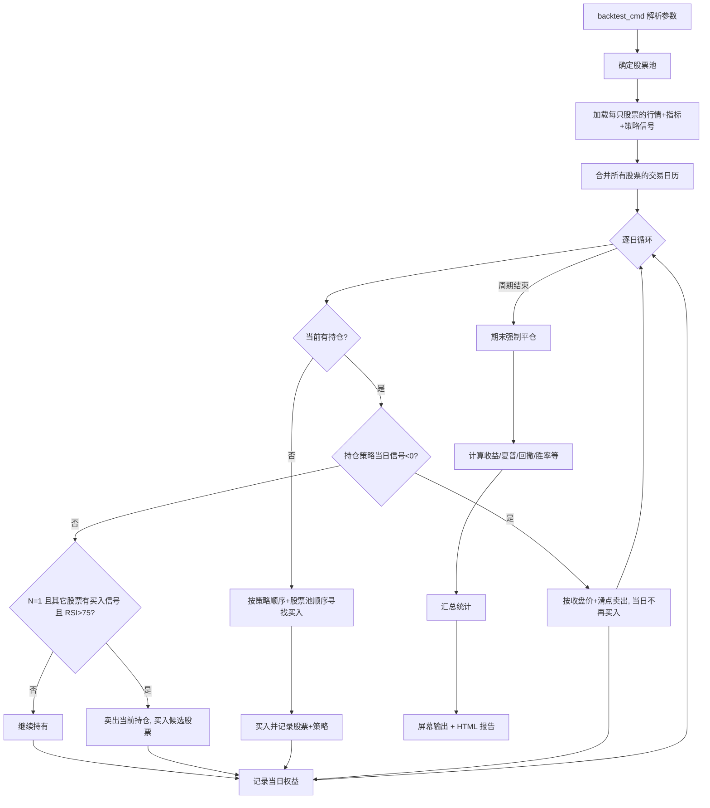

# backtest 单持仓轮动回测设计

本文说明 `backtest` 命令固定使用的单持仓轮动回测流程、信号语义、资金与持仓规则、指标口径和输出结构。

核心实现：`main.py:4397` `_run_onestock_backtest()`  
命令入口：`main.py:4678` `backtest_cmd()`  
策略统计：`main.py:4336` `_build_onestock_breakdown()`

---

## 1. 功能定位

`backtest` 采用“持仓轮动”回测模式，默认单持仓（`-n 1`），`-n N` 允许同时持有至多 N 只：

- 默认（`-n 1`）：任意时刻最多持有一只股票；空仓时按策略优先级和股票池顺序寻找买入信号；买入后记录触发买入的策略；只有“同一股票 + 同一策略”出现卖出信号时才清仓；清仓后可再次寻找新的买入机会；期末仍有持仓时按最后一个交易日收盘价强制平仓。
- `-n N>1`：每个交易日先处理各持仓的卖出信号，再用剩余空位按「策略顺序 + 股票池顺序」买入未持仓且发出买入信号的股票，直至补满 N 只（当日有卖出时不买入）。
  - 资金规则：`--fixcapital` 时每只买入金额固定为 `初始资金/N`（现金可为负）；否则每只买入金额 = `可用现金/(N-当前持股数)`。
- 本文其余章节描述默认 `-n 1` 的单持仓规则。

所有标的共享同一笔资金；普通批量/单股回测入口已停用。

---

## 2. 命令与选项

示例：

```bash
python3 main.py backtest \
    -sf input/pool.txt \
    -st 20200101 -e 20251231 \
    -g boll,macd \
```

### 2.1 固定单持仓规则

`backtest` 固定等同于原 `--onestock 0`：

- 空仓时按 `-g` 策略顺序选择买入信号的股票；
- 持仓期间忽略其它股票的买入信号；
- 不再提供换股模式。

### 2.2 相关选项

| 选项 | 作用 |
|------|------|
| `-s` / `-sf` | 指定股票池；未指定时默认读取 `input/pool.txt` |
| `--random` | 忽略 `-s/-sf`，按板块比例随机抽取 100 只，空仓时刷新股票池 |
| `-g` | 策略列表，顺序即买入优先级；`hold` 会被排除 |
| `-c` | 初始资金（万元） |
| `--fixcapital` | 每笔买入金额固定为 `-c` 指定金额；现金不足时仍按该金额买入，剩余现金可为负 |
| `--maxholddays N` | 信号层最大持股限制 |
| `--critera b1,s2` | BOMA 生效条件；缺省全部生效 |
| `--withdrawsell [ratio]` | 全命令可用；启用 ATR 动态止损，缺省 ratio=2，不指定则不执行回撤止损 |
| `--verbose` | 在 HTML 报告中增加“指数K线 + 权益曲线 + 买卖三角”单图 |
| `--seqnum/-sn` | BOLL 买入序号过滤 |
| `--src` | 数据源选择 |

注意：

- `backtest` 固定进入单持仓轮动流程，不进入普通批量回测/单股回溯路径；
- `--chart` 在单持仓轮动流程下不生效；`--verbose` 会生成指数K线/权益曲线单图并嵌入 HTML；
- 股票池为空、无有效数据、或策略中只有 `hold` 时直接报错返回；
- 大盘趋势为“过热”时始终禁止买入；`下跌`/`过冷` 趋势在 `--trendctl 1`（默认）时禁止买入；
- 大盘趋势为“过冷”时忽略最大回撤、最大持股天数和亏损止损等强制卖出，常规策略卖出仍执行；
- `--trendctl [N]`：`0`=不控制；`1`=下跌或过冷趋势禁止买入（按个股对应指数趋势）；默认 `1`；
- `--withdrawsell [ratio]` 适用于 analyze / scan / backtest / compare：上涨/过热时 N=ratio×1.2，下跌/过冷时 N=ratio×0.8，震荡时 N=ratio。

---

## 3. 总体流程



---

## 4. 股票池与数据加载

### 4.1 股票池来源

`backtest_cmd` 在进入 `_run_onestock_backtest` 前确定 `symbols`：

1. `--random`：从全市场按板块比例随机抽取 100 只，忽略 `-s/-sf`；
2. `-s` 与 `-sf`：合并、去重；
3. 都未指定：默认读取 `input/pool.txt`。

`_file_part` 用于报告文件名：

- `--random` → `random`
- `-sf` → 文件名（不含路径/扩展名）
- 仅 `-s` → 股票代码拼接

### 4.2 单只股票加载

`load_one(sym)`：

1. `DataFetcher.get_stock_data(sym, start-90天, end)`；
2. `add_all_indicators(df)`；
3. `_truncate_analysis_df(df, start_date)`，去掉预热期；
4. 对每个策略生成最终信号；
5. 返回 `(df, sigs)` 并缓存在 `loaded` 字典中。

加载失败或数据为空的股票会被静默跳过。股票池 >= 20 只时，每加载 10 只打印一次进度。

### 4.3 策略信号

```python
source_keys = [k for k in strat_keys if _strat_base(k) != 'hold']
```

- `hold` 作为基准策略，在单持仓轮动流程中被排除；
- 策略实例使用通用 `STRATEGY_MAP`，不使用 analyze 中的 ETF/指数专属参数；
- `strat_enhance` 当前固定为 0，增强参数已废弃；
- 信号由 `_generate_effective_signals()` 生成，包含：
  - 策略自身买卖条件；
  - BOLL / BOMA 的 `--seqnum` 过滤。

### 4.4 `--maxholddays` 条件

当前卖出条件：

```text
持股时间 > N 个交易日
且 收盘价 < BOLL 中线
且 持仓期最大回撤 > 10%
```

- 建仓后首次买入开始计时；
- 持仓期间重复买入不重置计时；
- 最大回撤按持仓期内最高收盘价到当前收盘价计算；
- 卖出后重置建仓计时和峰值；
- 屏幕不打印交易明细，但 HTML 报告仍保留。

---

## 5. 交易日历

```python
calendar = sorted(set().union(*[set(df.index) for df, _ in loaded.values()]))
```

- 取所有成功加载股票的日期并集；
- 循环按该联合日历推进；
- 某只股票当天没有行情时：
  - 不产生该股票的买卖；
  - 估值时用 `close.asof(d)` 取最近有效收盘价。

因此，停牌期间卖出信号会延后到有行情的交易日。

---

## 6. 持仓状态与交易执行

### 6.1 持仓结构

```python
hold = {
    'symbol': 股票代码,
    'sk': 触发买入的策略 key,
    'shares': 持股数,
    'cost': 买入成本（含佣金前的资金额度）,
    'entry_date': 买入日期,
    'entry_price': 买入执行价,
}
```

### 6.2 买入

`_buy(sym, sk, df, d)`：

```text
执行价 = 当日收盘价 × (1 + 滑点)
买入资金 = 初始资金（--fixcapital）或当前现金
持股数 = 买入资金 / (执行价 × (1 + 佣金))
现金 -= 买入资金
```

固定佣金/滑点：

```text
commission = 0.0003
slippage   = 0.0001
```

注意：`--fixcapital` 每次按初始资金额度买入，若此前亏损导致现金不足，现金会变为负数（等价于固定名义本金、不做现金约束）。

### 6.3 卖出

`_sell(d, reason)`：

```text
执行价 = 当日收盘价 × (1 - 滑点)
卖出收入 = 持股数 × 执行价 × (1 - 佣金)
现金 += 卖出收入
```

交易记录包含：

```text
entry_date, exit_date, symbol, strategy,
entry_price, exit_price, position,
return, holding_days, exit_reason
```

`exit_reason`：

| 值 | 含义 |
|----|------|
| `signal` | 持仓策略卖出；HTML 卖出原因显示具体触发（MACD死叉、BOLL上轨回落、RSI超买、最大回撤、最大持股天数等） |
| `replace` | 原 `--onestock 1` 换股（当前已停用） |
| `end` | 期末强制平仓 |

### 6.4 卖出优先级

每日循环顺序：

1. 若持仓，且持仓策略当日信号 `< 0`：卖出，`continue`，**当日不再买入**；
   （“过冷”时仅由最大回撤/最大持股天数触发的卖出已被抑制）
2. 若空仓且需要刷新随机池：刷新；
3. 若空仓：寻找买入；
4. 若持仓且 `N=1`：尝试换股；
5. 记录当日权益。

### 6.5 买入选择顺序

`_pick_buy(d)` 按：

```text
策略顺序（-g 的先后）
    → 股票池顺序
    → 当日该策略信号 > 0 的第一只
```

因此 `-g boll,macd` 表示 BOLL 优先于 MACD。

### 6.6 换股模式（已停用）

持仓期间，如果：

- 其它股票出现买入信号；
- 当前持仓 RSI14 > 75；
- 候选股票不是当前持仓；

则：

```text
卖出当前持仓（reason=replace）
→ 立即买入候选股票
```

不满足 RSI 条件时继续持有。

---

## 7. 权益曲线

每个交易日记录：

```text
equity = 现金 + 持仓市值
持仓市值 = 持股数 × 当日收盘价（缺失时用最近有效价）
```

期末仍有持仓时：

```text
按最后一个联合交易日收盘价强制卖出
equity[-1] = 清仓后现金
```

---

## 8. 指标计算

### 8.1 总体指标

`_calc_sharpe_drawdown(equity)`：

- 日收益率 = 权益曲线 `pct_change()`；
- 夏普比率：扣除年化无风险利率 3% 后计算；
- 最大回撤：权益曲线历史峰值到当前值的最大跌幅。

其他指标：

```text
总收益率 = (期末权益 - 初始资金) / 初始资金
年化收益率 = 总收益率 × 250 / 累计持股天数
胜率 = 盈利交易数 / 总交易数
盈利因子 = 总盈利 / |总亏损|
```

注意：这里的“年化收益率”是按累计持股天数折算，不是按回测自然日/年数折算。

### 8.2 回测结果汇总

`_build_onestock_breakdown()` 不再按策略拆分，只输出全部交易合并后的结果：

```text
指标 | 结果
```

指标行：

```text
总收益率、年化收益率、最大回撤、夏普比率、交易次数、
胜率、平均收益率、盈利因子、持股天数、
总盈亏额、最大单笔盈利、最大单笔亏损
```

其中：

- `总收益率` 显示 `总收益率 / 中位收益率 / 最高收益率 / 最低收益率`；
- `持股天数` 显示 `平均持股天数 / 中位持股天数 / 最大持股天数 / 最小持股天数`；
- 其余指标均为全部交易合并后的结果。

---

## 9. 屏幕与 HTML 输出

### 9.1 屏幕

```text
单持仓轮动回测
策略: BOLL, MACD
初始资金: ...
正在加载股票池（N 只）...
回测结果
[表格]
# 屏幕不打印交易明细（HTML 报告仍保留）
HTML报告已保存到: ...
回测完成!
```

### 9.2 HTML 报告

文件名：

```text
report/backtest_<file_part>_<start>_<end>_<strategy>_<mmddHHMM>_onestock.html
```

报告包含：

- 标的：`单持仓轮动(N只)`；
- 回测区间、初始资金、数据来源、生成时间；
- 阈值备注（ATR 止损、RSI、PE、seqnum）；
- 命令选项、软件版本；
- “回测结果”表；
- “交易明细”表（屏幕始终不打印，HTML 保留）；包含“买入原因”和“卖出原因”两栏，分别显示建仓和离场的具体策略/风控条件。
- 开启 `--verbose` 时增加“买入信号分组收益”和“卖出信号分组收益”表；每行按原因统计次数、次日OK率、3日OK率、总收益率、中位收益率、最高收益率、最低收益率，其中分组总收益率为组内交易收益率之和。次日OK率：买入分组为“次日收盘价较信号日上涨”的交易占比，卖出分组为“次日收盘价较信号日下跌”的交易占比，无下一交易日的交易不计入分母；3日OK率：买入分组为“之后第3个交易日收盘价较买入日上涨”的交易占比，卖出分组为“之后第3个交易日收盘价较卖出日下跌”的交易占比，未来交易日不足3日的交易不计入分母。若同一交易同时满足多个原因（如“卖出信号MACD/卖出信号ATR”），会分别计入各原因分类，不在组合分类中统计。
- 开启 `--verbose` 时增加“指数K线与权益曲线”单图：指数K线、权益曲线（次坐标轴）和买入红三角/卖出绿三角叠加在同一张图，不使用子图；指数K线位于下方、权益曲线位于上方，两者分区显示尽量减少交叉；指数K线与趋势线约占下方 2/3 高度，权益曲线位于上方约 1/3 区域并允许与K线少量重叠；权益轴上下限根据权益数据自动设置，刻度按万元显示（如 200 表示 200 万，不带“万”后缀）；股票代码标注在买入三角下方；权益曲线起点/终点附近标注对应权益值（万元，保留 2 位小数）；K线图底部与X轴之间增加上下两条相邻的大盘趋势粗线：上方为中证1000趋势、下方为沪深300趋势（红色=上涨、紫色=过热、绿色=下跌、蓝色=过冷、灰色=震荡）；K线初始使用中证1000，首次买入后切换为该股票对应指数（>200亿用沪深300，否则中证1000），之后每次买入再切换；沪深300与中证1000两条K线均完整绘制，非激活指数用灰色，激活指数彩色并置于灰色K线前方。

### 9.3 返回值

`_run_onestock_backtest()` 现在返回：

```python
{
    'result': result,
    'trades': trades,
    'equity': equity,
    'html_path': html_path,
    'chart_path': chart_path,
    'breakdown_headers': breakdown_headers,
    'breakdown_rows': breakdown_rows,
}
```

CLI 调用方忽略返回值；测试脚本可直接使用交易记录和统计结果。

---

## 10. 随机池模式

`--random` 时：

- 初始股票池由 `_random_pick_by_board()` 按：

```text
沪市主板 : 深市主板 : 创业板 : 科创板 = 6 : 5 : 5 : 2
```

随机抽取 100 只；

- `random_mode=True`；
- 每次“信号卖出后进入空仓”的下一轮循环，会重新抽取 100 只并重新加载；
- 换股（`replace`）不会触发刷新；
- 随机池刷新使用 `_sample_random_pool(random_count)`，默认 `random_count=100`。

---

## 11. 关键约束与注意事项

1. **单一持仓**：不会同时持有两只股票，也不做分批建仓/减仓。
2. **全仓买入**：默认使用全部现金；`--fixcapital` 使用固定初始资金额度。
3. **收盘价成交**：买入/卖出均按信号日收盘价加/减滑点，不按次日开盘价。
4. **无印花税**：当前仅模拟佣金和滑点。
5. **持仓天数按联合交易日历统计**：停牌或数据缺口可能使持仓天数偏大。
6. **换股不刷新随机池**：随机模式下只有信号卖出后才刷新。
7. **策略映射为通用策略**：不复用 analyze 的 ETF/指数专属参数。
8. **`--chart` 不生效；`--verbose` 生效**：单持仓流程不进入普通批量图表流程，但 `--verbose` 会额外生成指数K线与权益曲线单图并嵌入 HTML。
9. **`--maxholddays` 只影响信号**：不改变 onestock 的资金和持仓规则；大盘“过冷”时该强制卖出被抑制。
10. **报告文件名包含 `_onestock.html`**：避免与普通回测报告混淆。

---

## 12. 代码索引

| 功能 | 位置 |
|------|------|
| 命令入口 | `main.py:4678` `backtest_cmd()` |
| onestock 分支 | `main.py:4764` |
| 主回测函数 | `main.py:4397` `_run_onestock_backtest()` |
| 策略统计 | `main.py:4336` `_build_onestock_breakdown()` |
| 随机池抽样 | `main.py:3772` `_random_pick_by_board()` |
| 随机池刷新 | `main.py:4321` `_sample_random_pool()` |
| 信号生成 | `main.py:378` `_generate_effective_signals()` |
| 最大持股过滤 | `main.py:308` `_apply_max_hold_days()` |
| 夏普/回撤 | `main.py:708` `_calc_sharpe_drawdown()` |
| HTML 报告 | `main.py:1463` `_generate_backtest_html()` |
